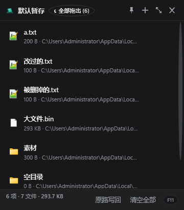

# StashBay

> Rak transit ringan untuk memindahkan berkas antarjendela: seret ke dalam, seret ke luar, selesai — tanpa perlu membuka jendela berdampingan.

[简体中文](../../README.md) · [English](../../README.en.md) · [繁體中文](README.zh-Hant.md) · [日本語](README.ja.md) · [한국어](README.ko.md) · [Español](README.es.md) · [Français](README.fr.md) · [Deutsch](README.de.md) · [Português](README.pt.md) · [Русский](README.ru.md) · [Italiano](README.it.md) · [العربية](README.ar.md) · [हिन्दी](README.hi.md) · [বাংলা](README.bn.md) · [ไทย](README.th.md) · [Türkçe](README.tr.md) · [Tiếng Việt](README.vi.md) · **Bahasa Indonesia**

 

[⬇ Unduh Versi Terbaru](https://github.com/rockbenben/stashbay/releases/latest)

Stasiun transit berkas lokal yang ringan untuk desktop Windows. Berjalan sepenuhnya luring tanpa unggahan ke cloud, tanpa permintaan jaringan, dan tanpa registrasi akun. Berfungsi sebagai rak transit cepat yang langsung ditutup setelah digunakan, maupun meja kerja berkas lengkap dengan dukungan Git, pencadangan snapshot, dan pembatalan satu klik.

---

## Cakupan Dukungan

| Dimensi | Spesifikasi Dukungan |
| :--- | :--- |
| **Sistem Operasi** | Windows 10 (1809+) / Windows 11 (dukungan native x64 dan ARM64) |
| **Kebutuhan Runtime** | Pemasang resmi dan versi portabel menyertakan runtime; build ramping membutuhkan .NET 10 Desktop Runtime |
| **Jenis Berkas** | Berkas dalam format apa pun dan folder bertingkat (struktur direktori relatif dipertahankan) |
| **Metode Masukan** | Pilihan File Explorer, daftar berkas papan klip, gestur goyangan mouse |
| **Tujuan Penulisan** | Disk lokal, folder jaringan bersama (UNC / drive terpetakan), repositori Git |
| **Berkas Besar** | Mendukung berkas tunggal > 2GB dan path panjang Windows (> 260 karakter) |
| **Hak Akses** | Berjalan dengan hak pengguna standar secara default (terpasang di `%LOCALAPPDATA%\Programs`); autostart admin opsional |
| **Lokasi Data** | Disimpan di `%LOCALAPPDATA%\StashBay\` secara default (kompatibel penuh dengan folder `FileStash` lama) |

---

## Mulai Cepat

1. **Unduh Program**: Unduh berkas pemasang `StashBay-vx.y.z-setup.exe` (tanpa perlu hak admin) atau paket portabel `StashBay-vx.y.z-win-x64.zip` dari [Releases](https://github.com/rockbenben/stashbay/releases/latest).
2. **Buka Rak**: Tekan pintasan <kbd>Win+Alt+S</kbd>; rak mini akan langsung terbuka di dekat kursor mouse pada monitor yang sedang aktif.
3. **Simpan Berkas**: Pilih berkas di File Explorer dan tekan <kbd>Win+Alt+S</kbd> lagi (atau seret ke rak, atau goyangkan mouse) — berkas yang dipilih akan langsung masuk ke rak.
4. **Seret Sekaligus**: Tarik pegangan `[⤹ Total X item]` di bagian bawah untuk mengekspor semua berkas ke jendela tujuan atau aplikasi obrolan dalam satu gerakan. Setelah kosong, rak akan otomatis menghilang dan tertutup.

---

## Fitur Utama

### Rak Transit Minimalis (Pengalaman DropPoint)
* **Ekspor Massal Sekali Tarik**: Seret pegangan penghitung untuk memindahkan semua berkas ke Explorer, aplikasi perpesanan, atau formulir web sekaligus.
* **Tutup Otomatis Saat Kosong**: Berkas yang berhasil dipindahkan akan dihapus dari rak; ketika rak kosong, jendela akan memudar dengan mulus.
* **Mengikuti Posisi Kursor**: Pintasan global mendeteksi monitor tempat mouse berada dan membuka rak langsung di lokasi tersebut.
* **Goyangkan Mouse untuk Menyimpan**: Saat menyeret berkas di Explorer, goyangkan mouse ke kiri dan kanan untuk membuka rak dan menyimpan berkas di tempat.
* **Bola Mengambang Magnetik**: Tombol kecil di tepi layar yang dapat dibuka dengan klik atau seret pendek, serta menempel secara magnetis ke tepi layar saat dilepas.
* **Banyak Rak Independen**: Klik ganda ikon baki sistem atau tekan <kbd>Ctrl+Shift+N</kbd> untuk membuka rak sementara baru; rak kosong akan dibersihkan secara otomatis.

### Pengelolaan Perubahan Branch Git & Pemulihan Aman
* **Pendeteksian Repositori**: Mengenali folder root untuk berkas Git; saat berpindah branch, notifikasi muncul untuk memulihkan berkas ke posisi semula dalam satu klik.
* **Pemeriksaan Kunci Sebelum Menulis**: Menggunakan Windows Restart Manager untuk mendeteksi berkas yang sedang dibuka oleh Office atau IDE sebelum menulis guna mencegah kerusakan.
* **Snapshot Aman Sebelum Menimpa**: Berkas yang akan ditimpa secara otomatis dicadangkan ke penyimpanan Blob lokal, dengan opsi pembatalan instan satu klik.
* **Lewati Berkas Identik Melalui Hash**: Melewati penulisan jika isi berkas persis sama untuk mempertahankan waktu modifikasi asli dan menghindari build ulang yang tidak perlu.

### Meja Kerja Lengkap
* **Empat Mode Tampilan**: Tampilan pohon (hierarki), daftar datar, dikelompokkan berdasarkan folder sumber, dan ubin ikon besar; pilihan tampilan tersimpan.
* **Mode Pemulihan Fleksibel**: Lokasi asli, folder tertentu, atau pemetaan root baru; mendukung jalur relatif lengkap, nama berkas saja, atau diratakan.
* **Pratinjau Konflik**: Tinjau rincian perubahan sebelum menerapkan: Tanya, Timpa, Lewati, atau Ganti Nama Otomatis.
* **Riwayat Operasi Batch**: Catatan log lengkap untuk setiap pemulihan; jika ada kegagalan parsial, Anda dapat mencoba lagi hanya untuk berkas yang gagal.

### 18 Bahasa Bawaan & Tema
* Dukungan resmi untuk 18 bahasa (100% kecocokan kunci diverifikasi oleh pengujian otomatis) dan dukungan tata letak cermin RTL untuk bahasa Arab (ar-SA).
* Terintegrasi mulus dengan mode gelap dan terang Windows menggunakan palet grafit netral.

---

## Pintasan Keyboard Umum

| Pintasan | Cakupan | Keterangan |
| :--- | :--- | :--- |
| <kbd>Win+Alt+S</kbd> | Global | Buka rak mini; jika ada berkas dipilih di Explorer, langsung disimpan |
| <kbd>Win+Alt+W</kbd> | Global | Buka meja kerja lengkap |
| <kbd>Win+Alt+V</kbd> | Global | Masukkan berkas yang ada di papan klip ke dalam rak |
| <kbd>Ctrl+V</kbd> | Dalam jendela | Tempel berkas papan klip ke dalam rak yang aktif |
| <kbd>Ctrl+Shift+N</kbd> | Dalam jendela | Buat rak kosong baru yang independen |
| <kbd>F11</kbd> / <kbd>Ctrl+E</kbd> | Dalam jendela | Beralih antara rak mini dan meja kerja lengkap |
| <kbd>Esc</kbd> | Dalam jendela | Pada meja kerja, ciutkan ke rak; pada rak, sembunyikan ke baki sistem |
| <kbd>Delete</kbd> | Daftar | Hapus item yang dipilih dari rak |

> [!TIP]
> Semua pintasan global dapat disesuaikan atau dimatikan di Pengaturan. Jika terjadi konflik dengan program lain, StashBay akan menampilkan peringatan yang jelas.

---

## Parameter Baris Perintah (CLI)

`StashBay.exe` menyediakan antarmuka baris perintah lengkap untuk integrasi dengan launcher eksternal atau skrip otomatisasi:

| Parameter | Keterangan |
| :--- | :--- |
| `--add <jalur...>` | Tambahkan satu atau beberapa berkas/folder ke dalam rak |
| `--group <nama>` | Digunakan bersama `--add` untuk menentukan rak tujuan (dibuat jika belum ada) |
| `--apply-here <folder>` | Tulis berkas di dalam rak ke folder yang ditentukan |
| `--apply-original` | Pulihkan berkas ke jalur relatif aslinya (cocok untuk Git) |
| `--show` | Tampilkan dan bawa jendela utama ke depan |
| `--minimized` | Mulai diminimalkan ke baki sistem (untuk startup otomatis Windows) |
| `--quit` | Tutup instance yang sedang berjalan dengan aman |
| `--unregister-shell` | Hapus menu konteks klik kanan, pintasan Send To, dan entri startup |

---

## Batasan yang Diketahui

* **Khusus Windows**: Terintegrasi secara mendalam dengan Windows Shell, komposisi DWM, dan kontrol akses; tidak ada rencana untuk sistem operasi lain.
* **Salinan Snapshot Bukan Pintasan**: Berkas disalin sebagai snapshot isi saat dimasukkan; perubahan berkas asli di kemudian hari tidak mengubah isi rak.
* **Mekanisme Single Instance**: Menjalankan ulang aplikasi akan meneruskan parameter ke proses yang sudah aktif di baki sistem tanpa membuat proses ganda.
* **Startup Otomatis Administrator**: Berjalan dengan izin pengguna biasa secara default. Jika Anda perlu menyeret berkas ke jendela berhak akses administrator, aktifkan opsi di Pengaturan dan setujui UAC. [Panduan Konfigurasi Startup](../admin-startup.md).

---

## Tentang 365 Open Source Plan

Proyek **#048** dari [365 Open Source Plan](https://github.com/rockbenben/365opensource) — satu orang + AI, 300+ proyek open-source dalam setahun.

[Ajukan ide Anda →](https://365.aishort.top/) · [Discord](https://discord.gg/PZTQfJ4GjX) · [Telegram](https://t.me/aishort_top)
